# Diagrams

Mermaid; GitHub renders these inline.

## 1. Modules and processes

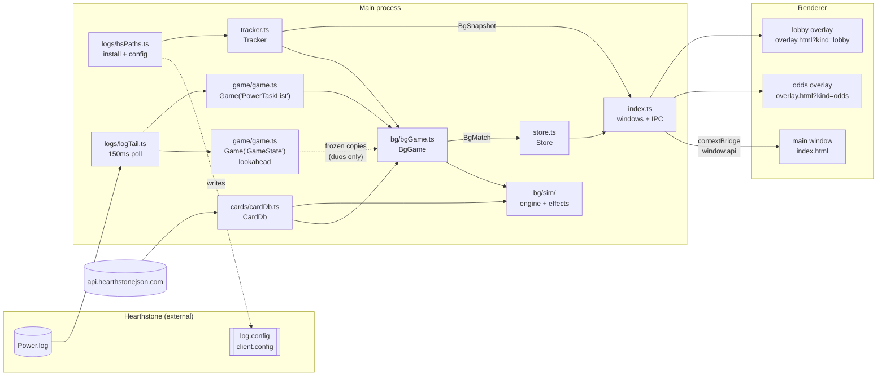

## 2. One log line, end to end

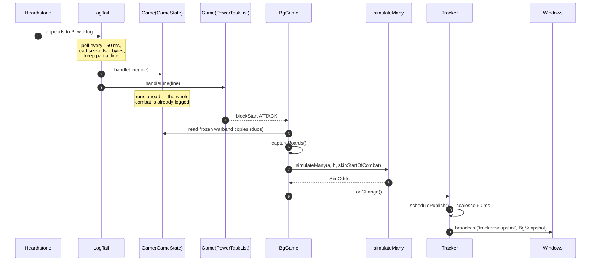

## 3. Battlegrounds round lifecycle

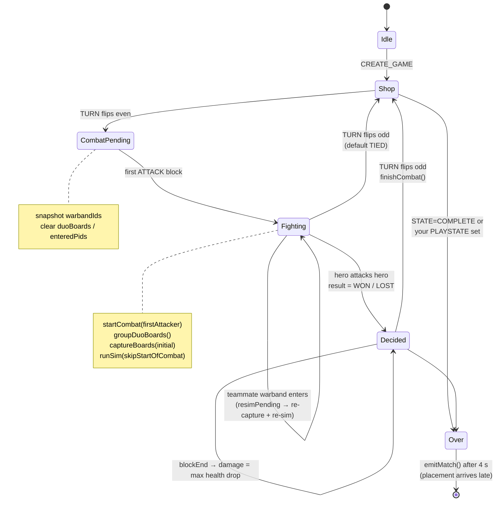

## 4. Simulator — one iteration

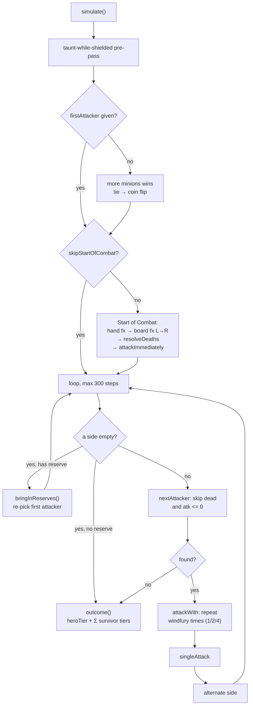

## 5. One attack, in order

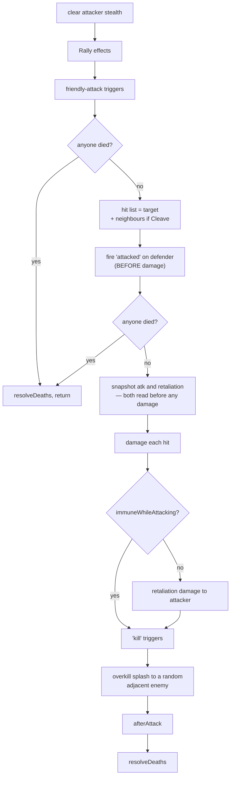

### `damage()`

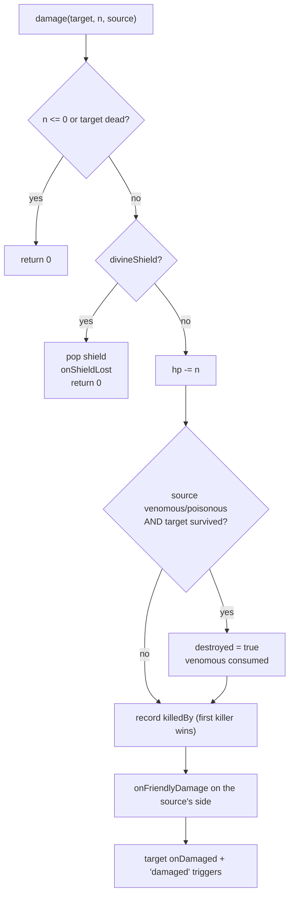

Note the shield absorbs poison too, because it returns before the poison check.

### `resolveDeaths()` — batch order

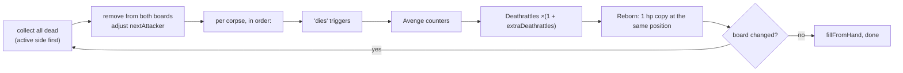

## 6. Card text → `CardFx`

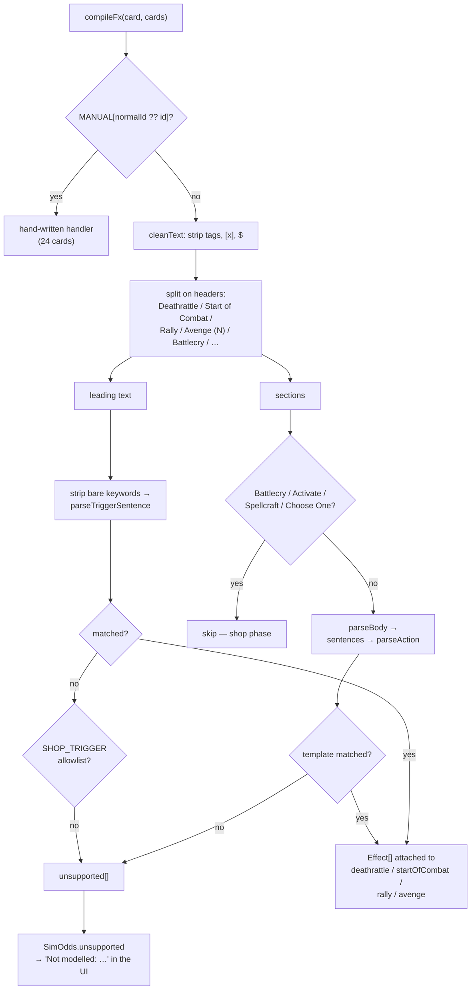

## 7. `TrackerStatus` decision

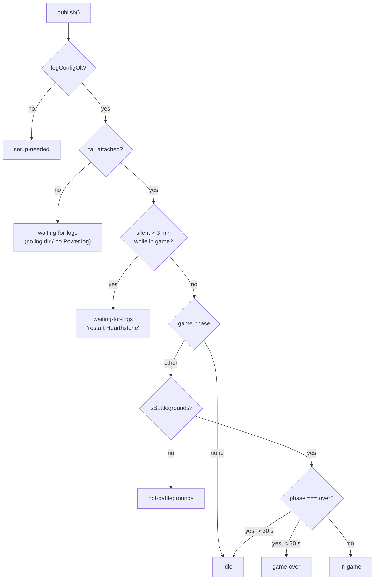

## 8. IPC map

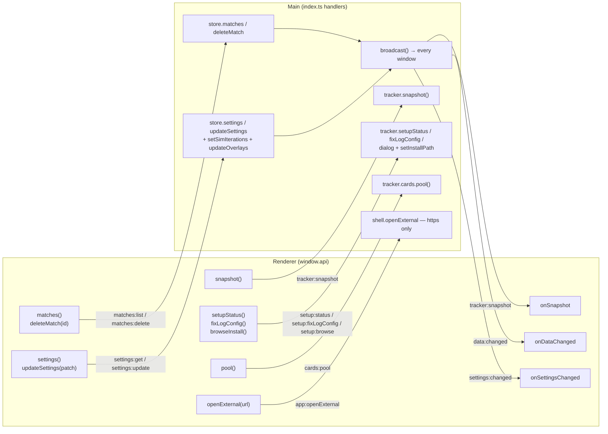

## 9. Duos — reconstructing the four warbands

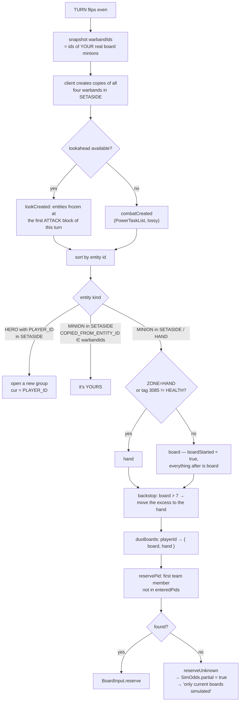

Tag `3085` is undocumented — see
[api-reference.md](api-reference.md#tag-3085).

## 10. Renderer component tree

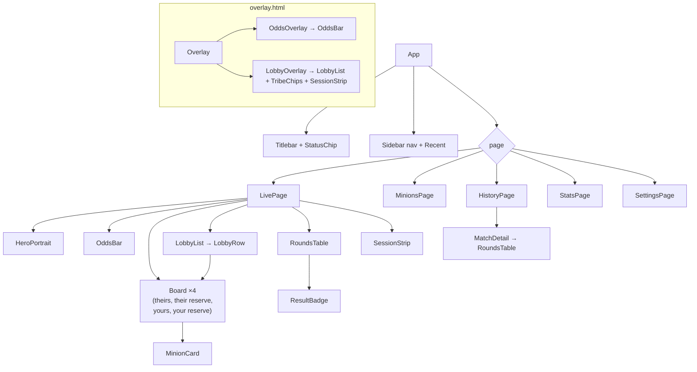

Shared components live in `components.tsx` and are used by both windows.
